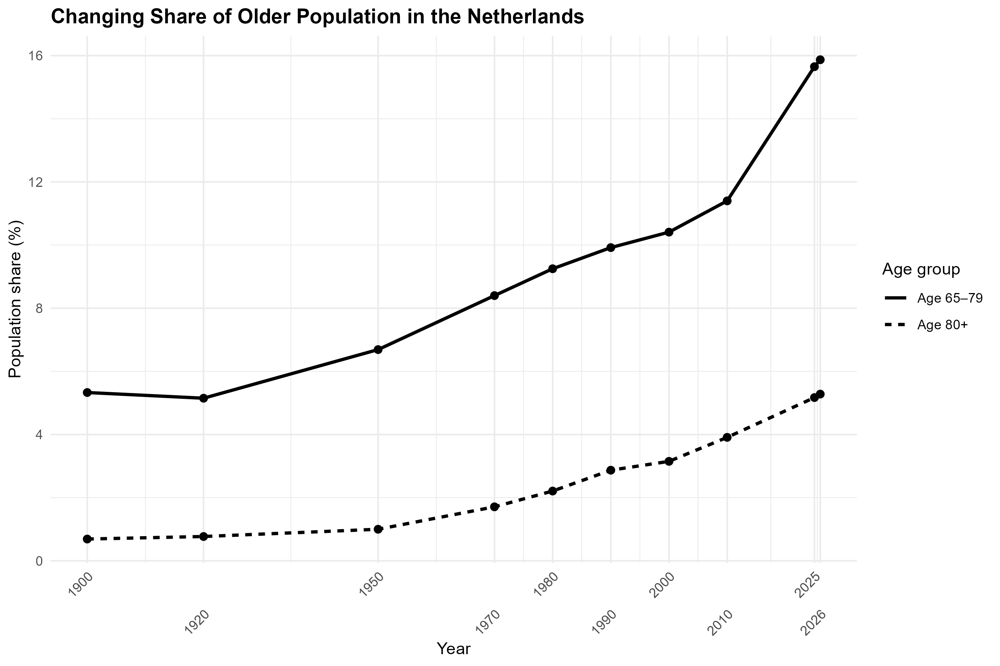
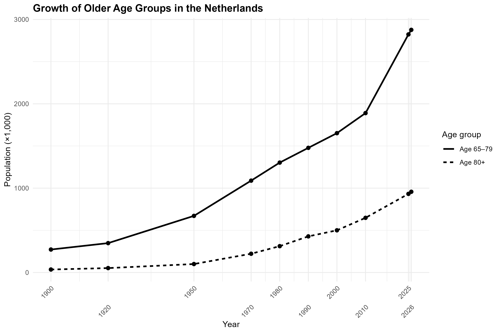

# Netherlands Population Ageing

## Overview

Population ageing is an important demographic change associated with increasing longevity and changes in the age structure of populations. This project examines the changing age structure of the Netherlands, with particular attention to the population aged 65–79 years and those aged 80 years and over.

Using selected years between 1900 and 2026, the analysis describes changes in the size and population share of these two older age groups. Particular attention is given to whether the oldest-old population (80+) has experienced faster proportional growth than the 65–79 age group.

This is a small descriptive demographic analysis conducted in R as part of a population studies portfolio.

---

## Research Questions

### Main Research Question

How has population ageing changed in the Netherlands between 1900 and 2026?

### Secondary Research Question

Has the population aged 80 years and over grown faster than the population aged 65–79 years over the same period?

---

## Data Source

The analysis uses data from **Statistics Netherlands (CBS)**, Table 85524ENG:

**Population; households and population dynamics; from 1899**

The dataset provides population statistics for the Netherlands, including population by age group.

For this project, the analysis uses the following variables:

- Year
- Total population
- Population aged 65–79 years
- Population aged 80 years and over

Population figures are reported by CBS in thousands.

The dataset used in this project contains 10 selected time points:

1900, 1920, 1950, 1970, 1980, 1990, 2000, 2010, 2025 and 2026.

The data were downloaded from Statistics Netherlands and imported into R for analysis.

---

## Methodology

The analysis was conducted using **R** and **RStudio**, with the `tidyverse` package used for data preparation, calculations and visualisation.

The analysis followed four main steps.

### 1. Data preparation

The original CBS dataset contains a larger number of demographic variables. Only the variables relevant to population ageing were retained for this analysis.

The selected variables were renamed for easier use in R:

- `Year`
- `Total_Population`
- `Age_65_79`
- `Age_80_Plus`

The data were also checked for missing values in the variables used for analysis.

### 2. Population share

The proportion of the total population belonging to each older age group was calculated for every selected year.

For the 65–79 age group:

Population share (%) =  
(Age 65–79 population / Total population) × 100

The same calculation was performed for the population aged 80 years and over.

This measure allows the size of each older age group to be considered relative to the total population.

### 3. Population growth

The percentage growth in the size of each older age group between 1900 and 2026 was calculated.

Growth (%) =  
((2026 population − 1900 population) / 1900 population) × 100

This was used to compare the proportional increase in the 65–79 and 80+ populations over the study period.

### 4. Change in population share

The change in the population share between 1900 and 2026 was calculated in percentage points.

Change in share =  
2026 population share − 1900 population share

This distinguishes changes in population share from percentage growth in the population itself.

---

## Analytical Approach

The project uses a **descriptive longitudinal approach**.

The analysis does not attempt to establish causal relationships. Instead, it describes how the size and relative share of older age groups changed across the selected time points.

The main comparisons are:

- Population size of the 65–79 and 80+ age groups
- Population share of the 65–79 and 80+ age groups
- Percentage growth between 1900 and 2026
- Change in population share between 1900 and 2026
- Direct comparison of the beginning and end of the study period

---

## Key Findings

The analysis shows a substantial increase in the size of both older age groups in the Netherlands.

Between 1900 and 2026:

- The population aged 65–79 increased from **272 thousand to 2,877 thousand**.
- The population aged 80 years and over increased from **35 thousand to 957 thousand**.
- The 65–79 population increased by approximately **958%**.
- The 80+ population increased by approximately **2,634%**.

The 80+ population therefore experienced considerably faster proportional growth than the 65–79 population.

The population share of the two age groups also increased:

- The share aged 65–79 increased by approximately **10.5 percentage points**.
- The share aged 80+ increased by approximately **4.59 percentage points**.

Overall, the results indicate a substantial shift towards an older population structure in the Netherlands, with particularly rapid proportional growth among the oldest-old population.

---

## Visualisations

### Figure 1 — Changing Share of Older Population

This figure shows the percentage of the total Dutch population represented by the 65–79 and 80+ age groups across the selected years.



### Figure 2 — Growth of Older Age Groups

This figure shows the population size of the 65–79 and 80+ age groups across the selected years.



---

## Project Structure

```text
Netherlands-Population-Ageing/
│
├── raw/
│   └── table__85524ENG.csv
│
├── figures/
│   ├── figure1_ageing_share.png
│   └── figure2_older_population_size.png
│
├── 01_data_cleaning.R
├── 02_analysis.R
├── README.md
└── Netherlands-Population-Ageing.Rproj